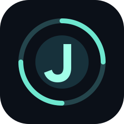
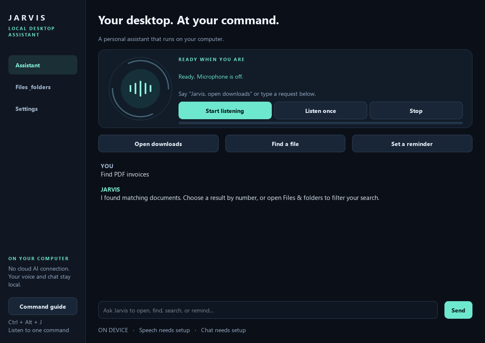
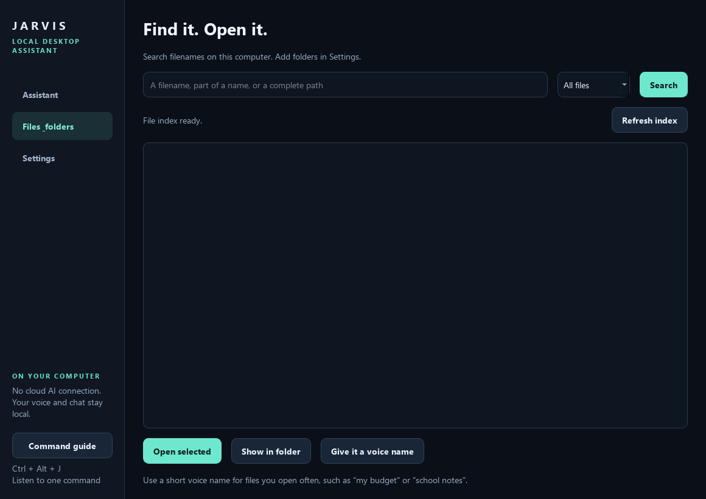
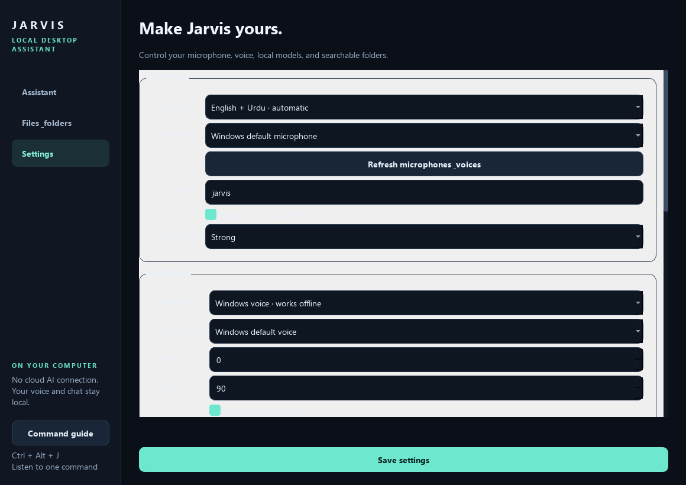

<div align="center">



# Jarvis · Local Desktop Assistant

**A voice-controlled desktop assistant that runs 100% on your own PC.**
No cloud. No API keys. Your voice, chats and files never leave this computer.


**Assistant page** · ask, dictate, chat with the local model


**Files & folders** · search everything by voice, give files spoken names


**Settings** · speech, voice, folders and local model setup


</div>

## What Jarvis can do

- **Voice + typed commands** — say *“Jarvis, open notepad”*; `Ctrl+Alt+J` listens once, `Ctrl+Alt+Esc` stops everything. English and Urdu (اردو) wake words and commands.
- **Apps, websites and media** — *“open youtube”*, *“open google”*, *“play lofi study music”*, *“search for Python tutorials”*; question forms like *“are you able to open YouTube?”* work too.
- **Real desktop control** — windows (focus/maximize/snap), keyboard shortcuts, typing, mouse, mouse grid, volume and media keys, screenshots.
- **Files** — create, copy, move, rename and recycle with spoken confirmation for destructive actions; filename search across your chosen folders; spoken file aliases (*“open my budget”*).
- **Local AI chat** — offline Qwen 2.5 answers, streaming replies, English/Urdu; deterministic calculators, notes, reminders (*“remind me in 10 minutes to drink water”*).
- **Offline speech** — local Whisper recognition with wake-word gating; Windows voices for replies, optional personal-voice cloning with your own recording.
- **Privacy by design** — every model runs on-device; a permission, confirmation and audit layer wraps every action.

## Quick start

Requires Windows, Python 3.11 and about 1.3 GB for the two local models.

```powershell
git clone https://github.com/tatheer583/jarvis-ai-assistant.git
cd jarvis-ai-assistant

# 1. One-time setup: creates the private runtime and installs dependencies
powershell -File scripts\setup_local.ps1

# 2. One-time model download (Whisper speech + Qwen chat, ~1.3 GB)
& "$env:LOCALAPPDATA\Jarvis\runtime\Scripts\python.exe" -X utf8 scripts\download_models.py

# 3. Launch the assistant
Launch-Jarvis.cmd
```

Then say **“Jarvis, what can you do?”** — or type `help`.

Prefer the Tauri/React edition? `python Main.py` starts the same engine behind the included PyQt interface; building the packaged Tauri app is described in [desktop/README.md](desktop/README.md).

## How it works

```text
Voice ─┐
Typed ─┼─> Command parser ─> tool registry ─> policy/confirmation ─> audit ─> desktop/files/AI handlers
Chat  ─┘        (English + Urdu)                    (local-only, no network)
```

Deterministic parsing handles actions; only genuine questions fall through to the local chat model. Model output is always text — never an executable command. The stdio transport is UTF-8 and rejects unknown operations or renderer-supplied identity claims.

## Development

Use Python 3.11, the packages in `Requirements.txt`, Node/npm and Rust MSVC for the Tauri shell (optional). Optional speech-worker requirements are separate in `Requirements.voice.txt`.

```powershell
& "$env:LOCALAPPDATA\Jarvis\runtime\Scripts\python.exe" -B -m unittest discover -s scripts/tests -q
& "$env:LOCALAPPDATA\Jarvis\runtime\Scripts\python.exe" -B scripts/smoke_engine.py
& "$env:LOCALAPPDATA\Jarvis\runtime\Scripts\python.exe" -B scripts/preview_ui.py   # UI screenshots
```

`python Main.py --check` reports your local setup. `python Main.py --engine` runs the headless JSON-lines engine used by the Tauri shell. Model downloads are an explicit setup action; core commands work offline.

## Current security limits

The desktop runs in **local control mode: owner authentication is not configured.** Anyone who can reach the unlocked Windows session or microphone can issue supported commands — confirmation is not authentication. Raw keyboard/mouse control can drive other applications; this is not a sandbox against malware running as your Windows user, and chat history/notes are not encrypted.

The separate audit store records allowlisted metadata only, with user/SYSTEM directory permissions, and is not tamper-proof against the same Windows account. Face/voice enrollment exists as an isolated subsystem and does not yet authenticate desktop actions.

See [architecture and limits](docs/architecture.md) · [cleanup record](docs/cleanup-manifest.md) · [build instructions](desktop/README.md) · [Phase 1 validation history](docs/phase1-validation.md)

## License

[MIT](LICENSE) © M Tatheer
